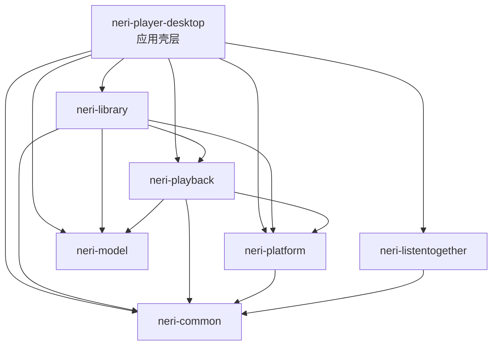

[English](./implementation_EN.md) | [中文](./implementation.md)

# 实现概览

本文面向开发者，说明进程边界、Rust workspace 的 crate 划分、宿主能力注入、前端分层与质量门禁。
用户向说明见 [README](../README.md)，开发流程与验证要求见 [CONTRIBUTING](../CONTRIBUTING.md)。
内容以源码为准；与源码不一致时请修正本文。

## 进程边界

应用由两个进程组成，通过 Tauri IPC 通信：

- **WebView（Vue 3 + Pinia）**：界面、路由与状态编排。前端不直接请求音乐平台，
  所有平台请求、文件与系统操作都经 `invoke('command_name', { camelCaseArgs })` 交给 Rust。
- **原生进程（Rust）**：`src-tauri/` 下的 Cargo workspace。应用壳层负责 Tauri 命令、窗口与托盘，
  业务逻辑在 `src-tauri/crates/` 下的领域 crate 中。

Tauri 把前端的 camelCase 参数映射为 Rust 的 snake_case 参数；返回值经 serde 序列化，
字段命名以对应结构体的 `#[serde(rename_all = ...)]` 为准。

## Rust workspace

`src-tauri/Cargo.toml` 同时是 workspace 根和应用壳层包 `neri-player-desktop`。
第三方依赖版本集中在 `[workspace.dependencies]`，成员 crate 用 `dep.workspace = true` 引用；
版本号、edition 与许可证由 `[workspace.package]` 统一声明。



| crate | 职责 | 可依赖的项目 crate |
| --- | --- | --- |
| [`neri-common`](../src-tauri/crates/neri-common/README.md) | 错误类型、原子写入、凭据存储、配置备份编解码、同步失败分类、事件出口 | — |
| [`neri-model`](../src-tauri/crates/neri-model/README.md) | 曲目模型、云同步 JSON / ProtoBuf 模型、B 站跳过规则 | — |
| [`neri-platform`](../src-tauri/crates/neri-platform/README.md) | 网易云、QQ 音乐、Bilibili、YouTube、LRCLIB 客户端，登录态与 Cookie Jar | common |
| [`neri-playback`](../src-tauri/crates/neri-playback/README.md) | 播放引擎、解码、远程拉流缓存、HLS、原生 DSP、队列、媒体会话 | common、model、platform |
| [`neri-library`](../src-tauri/crates/neri-library/README.md) | SQLite 用户库、本地曲库、歌词、统计、下载元数据、云同步 | common、model、platform、playback |
| [`neri-listentogether`](../src-tauri/crates/neri-listentogether/README.md) | 一起听协议、会话与 WebSocket 客户端 | common |

### 依赖规则

- 领域 crate 不依赖 `tauri*`，源码中不出现 `tauri::` 调用。需要宿主环境的能力通过接口注入（见下节）。
- 依赖方向只能沿上表的白名单，图中不得有环。白名单登记在
  [`config/quality/module-boundaries.json`](../config/quality/module-boundaries.json)，由质量门禁检查。
- 单个 `.rs` 文件的生产代码不超过 2000 行，单个目录不超过 16 个 `.rs` 文件；超出时按职责拆子模块。
- 每个 crate 都有 README，说明模块职责、宿主注入点与约束。

### 宿主能力注入

| 能力 | 领域侧接口 | 桌面端实现 |
| --- | --- | --- |
| 向前端投递事件（一起听连接、本地曲库扫描进度） | `neri_common::events::EventSink` | `src-tauri/src/events.rs` |
| YouTube 取流的代理策略与 PoToken 铸造（隐藏 WebView） | `neri_platform::api::youtube::host::YouTubeHost` | `src-tauri/src/platform_webview/` |
| 同步设备 ID 与因果计数器的持久化 | `neri_library::sync::state_store::SyncStateStore` | `src-tauri/src/sync_state.rs`（`sync-state.json`） |
| 远程拉流使用的 tokio 运行时 | `neri_playback::runtime::install` | `src-tauri/src/main.rs` 启动时注入 Tauri 运行时 |

网易云评论令牌同样依赖 WebView，但只被命令层使用，整体放在 `src-tauri/src/platform_webview/`。

### 应用壳层（`src-tauri/src/`）

| 路径 | 职责 |
| --- | --- |
| `main.rs` | Tauri Builder、插件、窗口事件、托盘、后台事件推送；唯一的 `generate_handler![...]` 注册表 |
| `commands/` | 按业务划分的 `#[tauri::command]` 入口，只做参数转换、状态获取与错误映射，业务逻辑放在 crate 中 |
| `state.rs` | 唯一被 `.manage()` 的 `AppState`：播放引擎、队列、可重建的 HTTP 客户端、Cookie Jar、登录态、一起听会话、下载登记 |
| `auth/cookies.rs` | 登录凭据持久化与旧版明文 store 迁移 |
| `settings/` | 设置的读取、校验与持久化 |
| `logging/` | 统一日志、有界内存缓冲与崩溃报告 |
| `events.rs`、`platform_webview/`、`sync_state.rs` | 上节的宿主能力实现 |

`build.rs` 注入 `BUILD_UUID`、`BUILD_TIMESTAMP` 与 `BUILD_VERSION`（`<git短哈希>.<MMddHHmm>`），
并为 Windows 链接目标嵌入应用清单。原生 DSP 与 FFmpeg 垫片由 `neri-playback` 的 `build.rs` 编译。

### 容易出错的地方

- **平台签名与加密**（`neri-platform`）：必须与平台现有方案逐字节一致，改动前对照 Android 端。
- **ProtoBuf 字段号**（`neri-model`）：与 Android `SyncDataModels.kt` 的 `@ProtoNumber` 手工对齐。
- **同步合并**（`neri-library::sync`）：三路合并（本地、远端、上次同步基线），不能改成最后写入者胜。
- **播放引擎锁**：命令层触碰 `PlayerEngine` 锁时必须走 `run_player_blocking`，不能在异步命令里直接持锁。
- **凭据存储**（`neri-common::security`）：按 `cfg(debug_assertions)` 切换实现，debug 与 release 都要检查。

## 前端（`src/`）

### 分层

依赖只能向下：

```text
types → utils → modules → composables / stores / integrations → components → views
```

| 层 | 内容 | 约束 |
| --- | --- | --- |
| `types/` | 共享类型（曲目、歌词等） | 不依赖其它层 |
| `utils/` | 无状态工具函数 | 不依赖 stores / components |
| `modules/` | 按领域组织的纯逻辑与 IPC 封装（播放、歌词、下载、持久化、设置、YouTube 解析等） | 不依赖 stores / components |
| `stores/` | Pinia 状态 | 可调用 IPC |
| `composables/` | 组合函数 | 可调用 IPC |
| `integrations/` | 宿主 / WebView 安装逻辑（托盘、桌面歌词桥、剪贴板、右键菜单、宿主背景） | 可依赖 stores |
| `components/`、`views/` | 界面 | 新的 IPC 调用不能放在这里 |

`components` 与 `views` 中现存的直接 `invoke()` 记录在 `ui_invoke_baseline`，只能减少。
历史超大文件记录在 `legacy_oversized`，只能变小。

### 状态与 IPC 约定

- 异步请求以序号或 generation 判断结果是否过期，过期结果不能覆盖新状态。
- 事件监听、定时器随组件或 store 作用域销毁时清理。
- 用户数据写入经 `modules/persistence/userData.ts` 的 `persistUserData` 串行发送。
- 每个界面状态变化都需要过渡动画。

## 质量门禁与测试

| 层级 | 命令 | 说明 |
| --- | --- | --- |
| 模块边界 | `python3 -B tools/quality/module_boundaries.py` | crate 依赖白名单、Tauri 隔离、文件 / 目录容量、前端分层与 UI 层 IPC 基线 |
| IPC 契约 | `python3 -B tools/quality/ipc_contract.py` | 命令定义、`generate_handler!` 注册与前端调用三方一致 |
| 门禁工具自测 | `python3 -B -m unittest discover -s tools/quality -p 'test_*.py'` | 用夹具仓库验证每类违规都会被拒绝 |
| 前端类型 | `pnpm typecheck` | 应用与测试两套 tsconfig |
| 前端 lint | `pnpm lint` | ESLint flat config |
| 前端测试 | `pnpm test` | `test:*` 回归脚本 + Vitest 单测 |
| 前端覆盖率 | `pnpm unit:coverage` | Vitest v8 覆盖率，阈值见 `vitest.config.ts` |
| CRAP | `pnpm crap` | 函数复杂度 × 未覆盖程度，公式与阈值对齐 Android 仓库；受检范围内 > 9 失败 |
| Rust 格式与 lint | `cargo fmt --all --check`、`cargo clippy --workspace --all-targets [--release] -- -D warnings` | 在 `src-tauri/` 下运行，debug 与 release 都检查 |
| Rust 测试 | `cargo test --workspace` 或 `cargo test -p <crate>` | 单元测试与 crate 内集成测试 |
| Rust 覆盖率 | `cargo llvm-cov --workspace` | 需要 `cargo-llvm-cov` 与 `llvm-tools-preview` |

门禁规则与基线说明见 [tools/quality/README.md](../tools/quality/README.md)。
以上检查都不能替代原生应用中的实际播放、登录、窗口与安装包验证。

## 常见改动入口

- **新增 IPC 命令**：在 `src-tauri/src/commands/` 实现命令，业务逻辑放进对应 crate；
  在 `main.rs` 的 `generate_handler!` 注册；前端在 stores / modules 中调用并声明返回类型；
  运行 IPC 契约门禁。
- **新增领域 crate**：在 `src-tauri/crates/<name>/` 创建，`Cargo.toml` 使用 workspace 继承；
  写 README；在 `module-boundaries.json` 登记允许的依赖；更新本文的依赖图。
- **新增前端模块**：先确定所属层；纯逻辑放 `modules/` 并补 Vitest 单测；
  需要宿主能力的安装逻辑放 `integrations/`。
