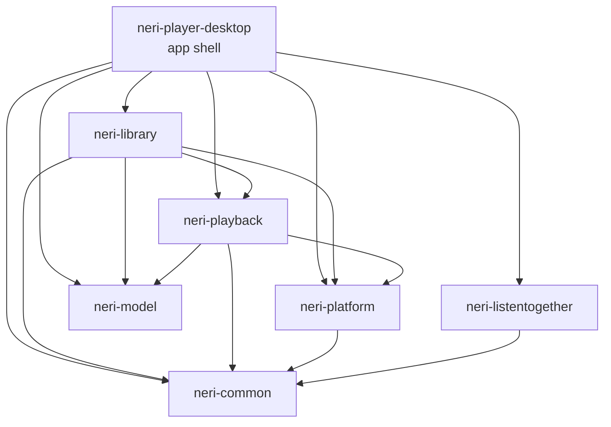

[English](./implementation_EN.md) | [中文](./implementation.md)

# Implementation Overview

This document is for developers. It covers the process boundary, the crates of the Rust workspace, host
capability injection, frontend layering, and quality gates. User-facing information lives in the
[README](../README_EN.md); the development workflow and verification requirements live in
[CONTRIBUTING](../CONTRIBUTING_EN.md). The source code is authoritative; fix this document when they disagree.

## Process boundary

The app runs as two processes that talk over Tauri IPC:

- **WebView (Vue 3 + Pinia)**: UI, routing, and state orchestration. The frontend never calls music platforms
  directly; every platform request, file operation, and system operation goes to Rust through
  `invoke('command_name', { camelCaseArgs })`.
- **Native process (Rust)**: the Cargo workspace under `src-tauri/`. The app shell owns Tauri commands, windows,
  and the tray; business logic lives in the domain crates under `src-tauri/crates/`.

Tauri maps camelCase arguments from the frontend to snake_case Rust parameters. Return values are serialized
with serde, and field names follow each struct's `#[serde(rename_all = ...)]`.

## Rust workspace

`src-tauri/Cargo.toml` is both the workspace root and the app shell package `neri-player-desktop`.
Third-party versions are declared once in `[workspace.dependencies]` and members reference them with
`dep.workspace = true`; version, edition, and license come from `[workspace.package]`.



| Crate | Responsibility | May depend on |
| --- | --- | --- |
| [`neri-common`](../src-tauri/crates/neri-common/README.md) | Errors, atomic writes, credential storage, config backup codec, sync failure classification, event outlet | — |
| [`neri-model`](../src-tauri/crates/neri-model/README.md) | Track model, cloud sync JSON / ProtoBuf models, Bilibili skip rules | — |
| [`neri-platform`](../src-tauri/crates/neri-platform/README.md) | NetEase, QQ Music, Bilibili, YouTube, LRCLIB clients; login state and cookie jar | common |
| [`neri-playback`](../src-tauri/crates/neri-playback/README.md) | Playback engine, decoding, remote stream cache, HLS, native DSP, queue, media session | common, model, platform |
| [`neri-library`](../src-tauri/crates/neri-library/README.md) | SQLite user database, local library, lyrics, statistics, download metadata, cloud sync | common, model, platform, playback |
| [`neri-listentogether`](../src-tauri/crates/neri-listentogether/README.md) | Listen Together protocol, session, and WebSocket client | common |

### Dependency rules

- Domain crates do not depend on `tauri*` and never call `tauri::`. Capabilities that need the host are
  injected through interfaces (next section).
- Dependencies follow the allow-list above and the graph must stay acyclic. The allow-list lives in
  [`config/quality/module-boundaries.json`](../config/quality/module-boundaries.json) and is enforced by the
  quality gate.
- A `.rs` file holds at most 2000 production lines and a directory at most 16 `.rs` files; split by
  responsibility when a limit is reached.
- Every crate has a README describing its modules, host injection points, and constraints.

### Host capability injection

| Capability | Domain interface | Desktop implementation |
| --- | --- | --- |
| Emitting frontend events (Listen Together connections, local library scan progress) | `neri_common::events::EventSink` | `src-tauri/src/events.rs` |
| Proxy policy and PoToken minting (hidden WebView) for YouTube playback | `neri_platform::api::youtube::host::YouTubeHost` | `src-tauri/src/platform_webview/` |
| Persisting the sync device ID and causal counter | `neri_library::sync::state_store::SyncStateStore` | `src-tauri/src/sync_state.rs` (`sync-state.json`) |
| tokio runtime used by remote streaming | `neri_playback::runtime::install` | Installed from `src-tauri/src/main.rs` at startup |

The NetEase comment token also needs a WebView; only the command layer uses it, so it lives entirely in
`src-tauri/src/platform_webview/`.

### App shell (`src-tauri/src/`)

| Path | Responsibility |
| --- | --- |
| `main.rs` | Tauri builder, plugins, window events, tray, background event pushes; the single `generate_handler![...]` list |
| `commands/` | `#[tauri::command]` entry points by domain. They convert arguments, fetch state, and map errors; business logic stays in crates |
| `state.rs` | The single `.manage()`d `AppState`: playback engine, queue, rebuildable HTTP client, cookie jar, login state, Listen Together session, download registry |
| `auth/cookies.rs` | Credential persistence and migration from the legacy plaintext store |
| `settings/` | Loading, validating, and persisting settings |
| `logging/` | Unified logging, bounded in-memory buffer, and crash reports |
| `events.rs`, `platform_webview/`, `sync_state.rs` | Host capability implementations from the previous section |

`build.rs` injects `BUILD_UUID`, `BUILD_TIMESTAMP`, and `BUILD_VERSION` (`<git-short-hash>.<MMddHHmm>`) and
embeds the application manifest into Windows link targets. The native DSP and the FFmpeg shim are compiled by
the `build.rs` of `neri-playback`.

### Fragile areas

- **Platform signing and encryption** (`neri-platform`) must match the platforms byte for byte; compare with
  the Android client before changing them.
- **ProtoBuf tags** (`neri-model`) are hand-aligned with `@ProtoNumber` in Android `SyncDataModels.kt`.
- **Sync merging** (`neri-library::sync`) is three-way (local, remote, last synced base); never replace it
  with last-write-wins.
- **Playback engine lock**: commands that touch the `PlayerEngine` lock go through `run_player_blocking`;
  never hold it inside an async command.
- **Credential storage** (`neri-common::security`) switches implementation on `cfg(debug_assertions)`;
  check both debug and release.

## Frontend (`src/`)

### Layers

Dependencies only point downwards:

```text
types → utils → modules → composables / stores / integrations → components → views
```

| Layer | Contents | Constraints |
| --- | --- | --- |
| `types/` | Shared types (tracks, lyrics, ...) | Depends on no other layer |
| `utils/` | Stateless helpers | No stores / components |
| `modules/` | Domain logic and IPC wrappers (playback, lyrics, downloads, persistence, settings, YouTube parsing, ...) | No stores / components |
| `stores/` | Pinia state | May call IPC |
| `composables/` | Composition functions | May call IPC |
| `integrations/` | Host / WebView installers (tray, desktop lyrics bridge, clipboard, context menu, host background) | May depend on stores |
| `components/`, `views/` | UI | No new IPC calls here |

Existing direct `invoke()` calls in `components` and `views` are recorded in `ui_invoke_baseline` and may only
decrease. Historical oversized files are recorded in `legacy_oversized` and may only shrink.

### State and IPC conventions

- Async requests carry a sequence number or generation; stale results must never overwrite newer state.
- Event listeners and timers are cleaned up when their component or store scope is disposed.
- User data writes are serialized through `persistUserData` in `modules/persistence/userData.ts`.
- Every UI state change needs a transition.

## Quality gates and tests

| Level | Command | Notes |
| --- | --- | --- |
| Module boundaries | `python3 -B tools/quality/module_boundaries.py` | Crate allow-list, Tauri isolation, file / directory size, frontend layering, UI-layer IPC baseline |
| IPC contract | `python3 -B tools/quality/ipc_contract.py` | Command definitions, `generate_handler!` registrations, and frontend calls agree |
| Gate self-tests | `python3 -B -m unittest discover -s tools/quality -p 'test_*.py'` | Fixture repositories prove every violation type is rejected |
| Frontend types | `pnpm typecheck` | App and test tsconfigs |
| Frontend lint | `pnpm lint` | ESLint flat config |
| Frontend tests | `pnpm test` | `test:*` regression scripts plus Vitest unit tests |
| Frontend coverage | `pnpm unit:coverage` | Vitest v8 coverage; thresholds in `vitest.config.ts` |
| CRAP | `pnpm crap` | Function complexity × lack of coverage, same formula and thresholds as the Android repository; > 9 fails inside the gate scope |
| Rust format and lint | `cargo fmt --all --check`, `cargo clippy --workspace --all-targets [--release] -- -D warnings` | Run in `src-tauri/`; debug and release are both checked |
| Rust tests | `cargo test --workspace` or `cargo test -p <crate>` | Unit tests and in-crate integration tests |
| Rust coverage | `cargo llvm-cov --workspace` | Needs `cargo-llvm-cov` and `llvm-tools-preview` |

Gate rules and baselines are described in [tools/quality/README_EN.md](../tools/quality/README_EN.md).
None of these checks replace verifying real playback, login, windows, and installers in the native app.

## Common changes

- **New IPC command**: implement it in `src-tauri/src/commands/` with the business logic in the matching crate;
  register it in `generate_handler!` in `main.rs`; call it from a store or module on the frontend with a
  declared return type; run the IPC contract gate.
- **New domain crate**: create `src-tauri/crates/<name>/` with workspace inheritance in `Cargo.toml`; write a
  README; register its allowed dependencies in `module-boundaries.json`; update the graph in this document.
- **New frontend module**: decide its layer first; pure logic goes in `modules/` with Vitest unit tests;
  installers that need host capabilities go in `integrations/`.
